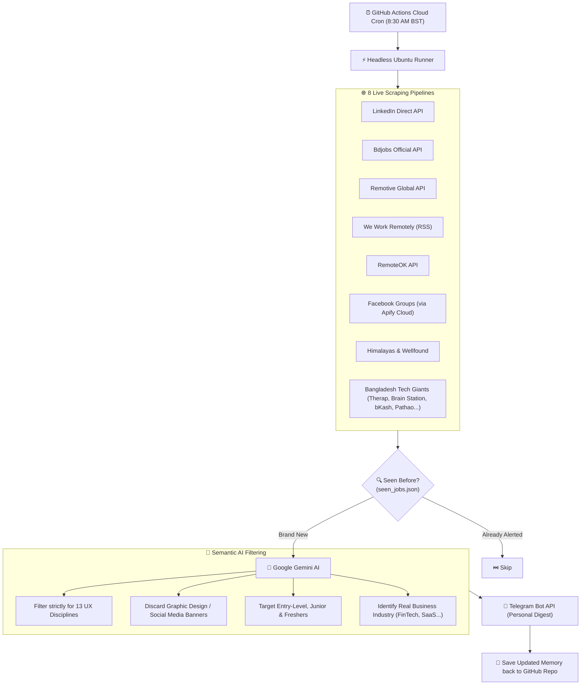

# 🤖 JobFather — Autonomous AI Job Search Engine for UX Designers

> An open-source, serverless AI agent that automatically scrapes, filters, and curates junior UX & Product Design opportunities across 8 platforms every morning, delivering a quiet daily digest directly to Telegram.

[](https://github.com/features/actions)
[](https://ai.google.dev/)
[](https://telegram.org/)
[](https://opensource.org/licenses/MIT)

---

## 💡 Why JobFather?

Job searching as an entry-level designer is exhausting. Opening 100 tabs every morning, sifting through search results full of *"Senior 5+ years"* roles, and dodging *"UX Designer"* jobs that secretly just want social media banners drains the creative energy you should be putting into case studies and portfolio building.

**JobFather handles the grunt work.** 

Every morning at 8:30 AM BST, it wakes up in the cloud, crawls 8 different job platforms, uses Gemini AI to filter out noise and deceptive titles, checks a deduplication database so you never see the same circular twice, and pings your Telegram with clean, curated leads.

---

## 🏗️ System Architecture



---

## 🛡️ Production Engineering & Reliability Highlights

* **Chronological ISO Deduplication:** Upgraded `seen_jobs.json` to an ordered `{url: timestamp}` ledger. Retains the newest 1,000 jobs sorted by discovery date so older jobs prune deterministically.
* **Prompt Injection Defense:** All scraped text is quarantined within `<untrusted_scraped_circulars>` XML boundaries with explicit system directives preventing prompt hijacking.
* **Pipeline Telemetry:** Live per-scraper health checks and discovery statistics automatically rendered to GitHub Actions Step Summary (`$GITHUB_STEP_SUMMARY`).
* **Pinned Dependencies:** Strict version locking in `requirements.txt` for deterministic, zero-surprise cloud runner builds.
* **Telegram Auto-Chunking:** Automatically chunks messages exceeding 3,900 characters to prevent silent truncation under Telegram's 4,096-char ceiling.
* **AI Model Fallback Chain:** Automatically cycles through verified production models (`gemini-2.5-flash`, `gemini-3.8-flash`, `gemini-3.5-flash-lite`, `gemini-2.0-flash`, `gemini-1.5-flash`) with error-aware retry backoff if Google API experiences high traffic.

---

## ⚠️ Known Limitations & Design Trade-offs

* **HTML Scraper Maintenance:** Direct web scrapers (such as LinkedIn guest API and Bdjobs) depend on public HTML structures. Upstream DOM changes may require selector updates.
* **Search Snippet Fallbacks:** For portals without direct open APIs, web query snippets are evaluated as initial leads rather than full-page descriptions.
* **Third-Party API Quotas:** Google Gemini and Apify operate on free-tier limits. JobFather includes exponential backoff, stealth fallbacks, and memory protection when limits are reached.

---

## 🔮 Engineering Roadmap

- [x] Automated test suite verifying memory persistence, Telegram chunking, and card-level deduplication
- [ ] SQLite persistence layer for multi-profile candidate indexing
- [ ] Webhook-based interactive Telegram buttons (e.g. `[Save Job]`, `[Apply Now]`)

---

## 🎯 What JobFather Filters For

### 13 Target UX Disciplines:
1. **UX Designer**
2. **UI/UX Designer / Product Designer**
3. **UX Researcher**
4. **Interaction Designer**
5. **Information Architect**
6. **UX Strategist**
7. **Service Designer**
8. **Accessibility Specialist (a11y)**
9. **AI UX Designer**
10. **AI Agent Designer**
11. **Design Engineer (UX Engineer)**
12. **Design System Specialist**
13. **Product Design Intern / Trainee**

### Negative Filters (Auto-Discarded):
* ❌ Roles requiring 3–5+ years of experience
* ❌ Graphic design, print flyers, social media banners, marketing graphics
* ❌ Deceptive circulars using "UX" just for keyword clicks

---

## 🚀 How to Set This Up for Yourself

You can easily fork and customize this bot for your own job search:

### 1. Fork this Repository
Click the **Fork** button in the top-right corner to copy this project to your GitHub account.

### 2. Configure Your Secrets
Go to your forked repository's **Settings ➡️ Secrets and variables ➡️ Actions**, and add:

| Secret Name | How to Get It |
| :--- | :--- |
| `TELEGRAM_BOT_TOKEN` | Create a free bot with [@BotFather](https://t.me/BotFather) on Telegram |
| `TELEGRAM_CHAT_ID` | Message [@userinfobot](https://t.me/userinfobot) to get your Chat ID |
| `GEMINI_API_KEY` | Generate a free API key at [Google AI Studio](https://aistudio.google.com/) |
| `APIFY_TOKEN` | Get free $5/month credits from [Apify Console](https://console.apify.com/) |

### 3. Customize Your Priorities
Open `jobfinder/jobfather.py` and modify the prompt inside `filter_with_ai_and_notify()` to match your dream job criteria, target locations, or experience level.

---

## 📁 Project Structure

```
├── .github/workflows/
│   └── daily_jobfather.yml    # Serverless GitHub Actions daily cron schedule
├── jobfinder/
│   ├── jobfather.py           # Core scraper, AI pipeline & Telegram bot engine
│   ├── requirements.txt       # Python dependencies
│   ├── seen_jobs.json         # Deduplication memory ledger
│   └── .env.example           # Environment variable template
├── tests/
│   ├── __init__.py            # Test package marker
│   └── test_jobfather.py      # Automated unit tests for DB, Telegram & matching
└── README.md                  # Project documentation
```

---

## 👩‍💻 Author

**Farhana Mahbuba Laboni**  
*UX Designer with a B.Sc in Computer Science & Engineering*  
[LinkedIn Profile](https://www.linkedin.com/in/farhanamlaboni/)

---

## 📄 License
This project is open-source under the [MIT License](LICENSE).
